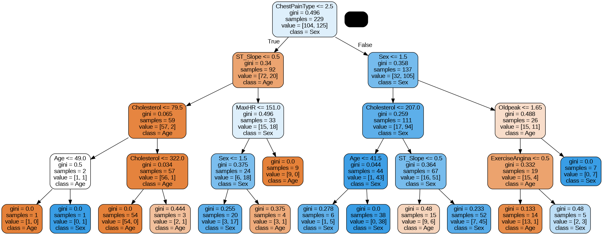
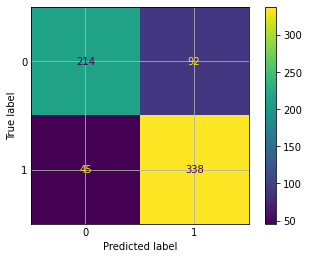
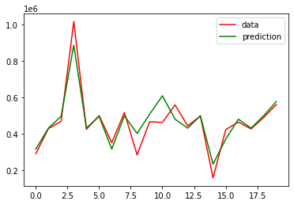

# Decision Trees

**Classification and regression trees on four datasets**

   

## Overview

Supervised learning with **decision trees** for both classification and regression. Each notebook follows the
same steps: import of libraries, preprocessing, training and prediction, evaluation (including cross-validation)
and visualisation of the tree.

| Notebook | Problem | Target | Result |
| --- | --- | --- | --- |
| [Heart](https://colab.research.google.com/github/Steven-Macas/ArbolDecision/blob/main/heart_SAA_stevenMacas_Arbol_Decision.ipynb) | Classification | Heart disease (yes / no) | **80.1 %** accuracy |
| [Wine](https://colab.research.google.com/github/Steven-Macas/ArbolDecision/blob/main/vino_SAA_stevenMacas_Arbol_Decision.ipynb) | Classification | Wine quality | 56.3 % accuracy |
| [Housing](https://colab.research.google.com/github/Steven-Macas/ArbolDecision/blob/main/housing_SAA_stevenMacas_Arbol_Decision.ipynb) | Regression | House price | MAE ≈ 68,800 |
| [Bike](https://colab.research.google.com/github/Steven-Macas/ArbolDecision/blob/main/bike_SAA_stevenMacas_Arbol_Decision.ipynb) | Regression | Bikes rented per hour | MAE 21.6 |

## Results

<table>
  <tr><td align="center" valign="top"> Heart – trained decision tree</td><td align="center" valign="top"> Heart – confusion matrix</td><td align="center" valign="top"> Housing – real vs predicted</td></tr>
</table>

*The notebooks are written in Spanish.*

---

Made by <b>Steven Macas</b> — Data Engineer &amp; Data Analyst · <a href="https://gointy.com">gointy.com</a> · <a href="https://www.linkedin.com/in/steven-macas">LinkedIn</a> · <a href="https://github.com/Steven-Macas">GitHub</a>
